# Звіт до лабораторної роботи №3

ПІБ: Конашук Владислав Сергійович
Група: ІПЗ-21
Склад команди: 1 особа (В.Конашук)
Тема проєкту: Волинь (туристичний путівник)

## Особистий внесок
Робота реалізована власними силами із залученням ШІ. Мій внесок у лабораторну:
- налаштував середовище розробки (python, git, репозиторій на github)
- створив flask застосунок "app.py", з чотирма маршутками
- створив сторінки "Головна", "Меню", "Контакти" та "Про нас"
- щоб перевірити сайт на телефоні, використав ngrok локальна адреса з телефона недоступна, а Wi-Fi не спрацював через точку доступу. Ngrok дав публічне посилання, і я перевірив адаптивність і меню на реальному пристрої
- підготував цей звіт

## Скріншоти
### Головна
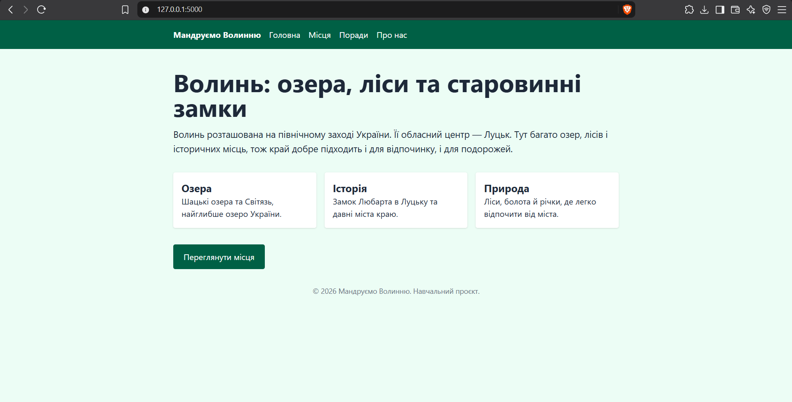
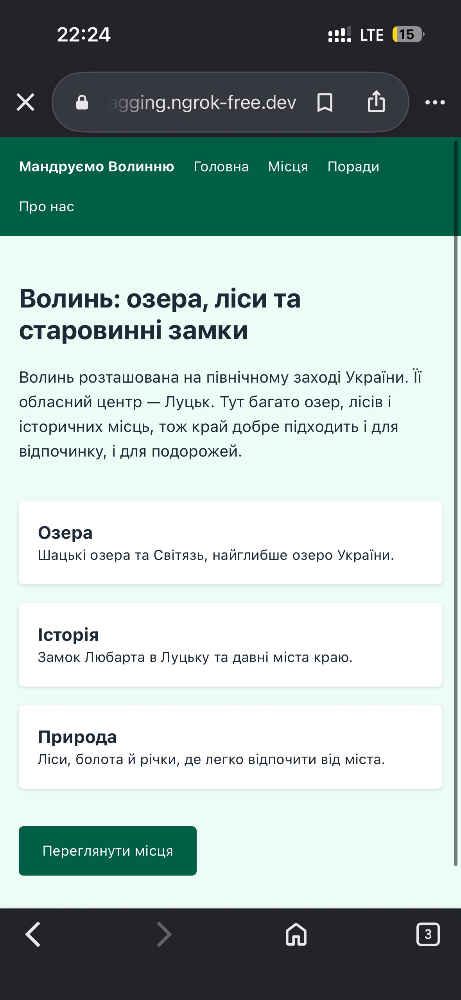

### Про нас
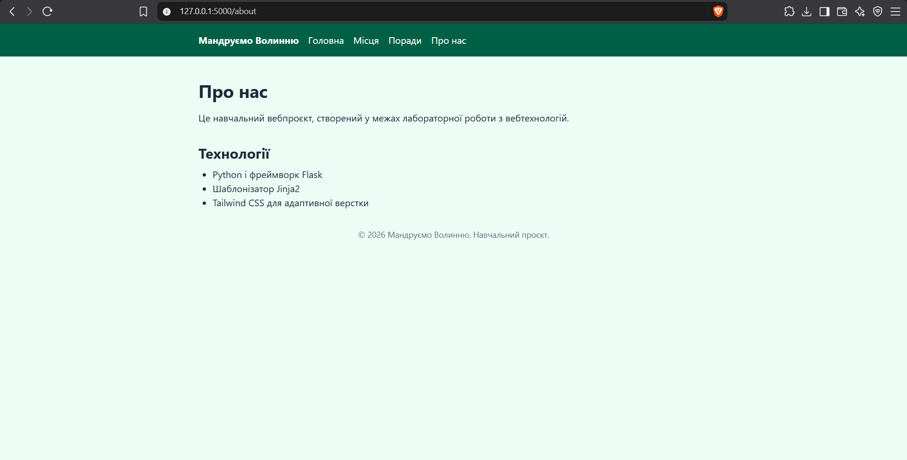
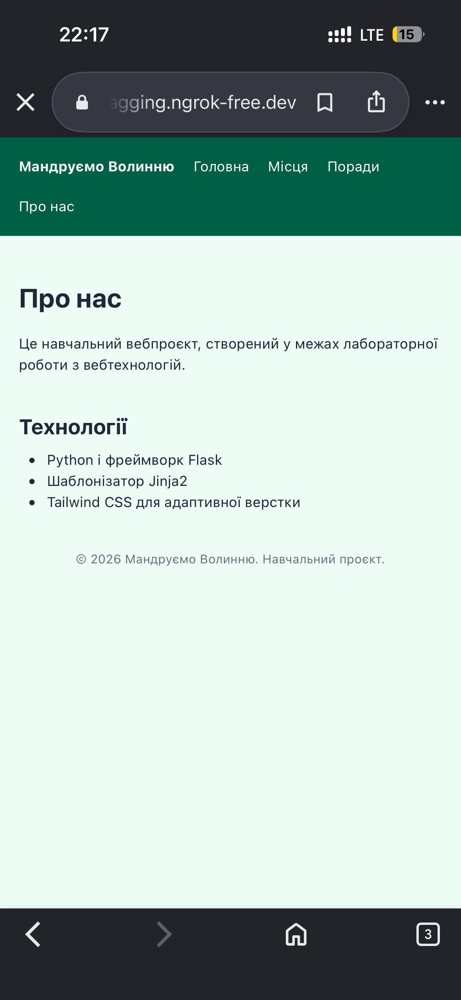

### Місця
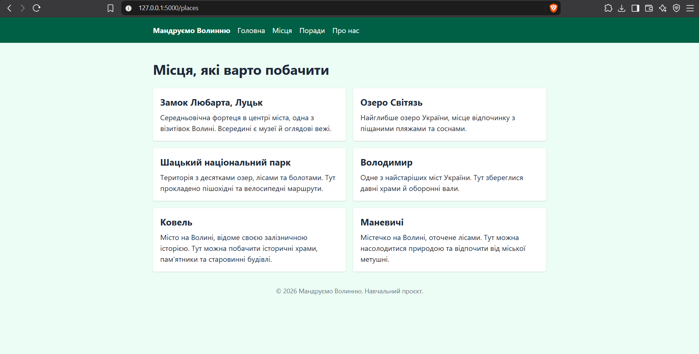
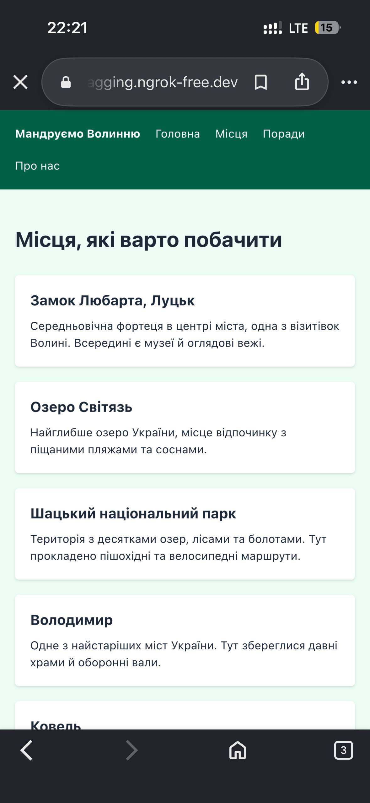
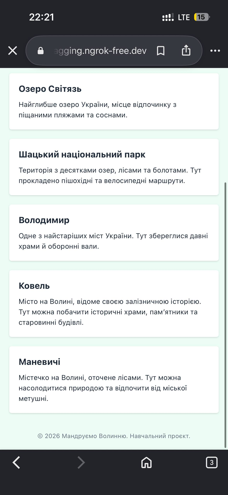

### Поради
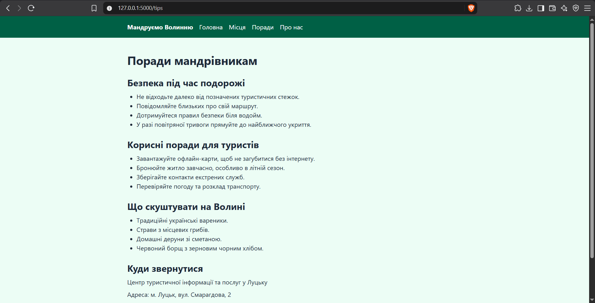
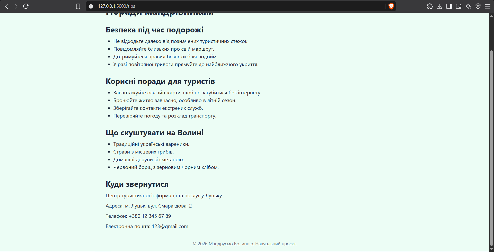
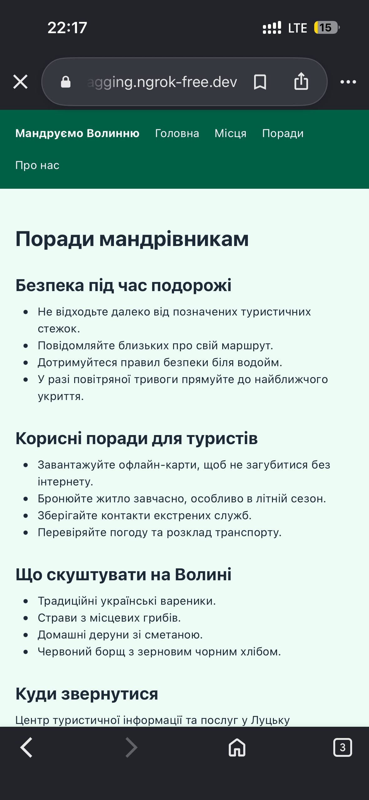
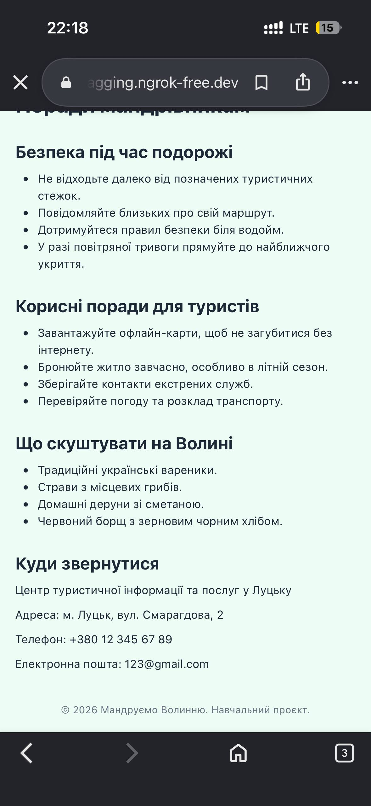

### Труднощі та їх вирішення

- помилка `ModuleNotFoundError: No module named 'flask'`. З'явилась під час запуску `python app.py`: проєкт було відкрито без активованого віртуального середовища. Активував `.venv` і встановив Flask (`pip install flask`)
- політика виконання скриптів у PowerShell. Активація `.venv` могла блокуватись, тому дозволив запуск скриптів командою `Set-ExecutionPolicy -Scope Process -ExecutionPolicy RemoteSigned`
- перевірка сайту на телефоні. Локальна адреса `127.0.0.1:5000` з телефона недоступна, а підключення по Wi-Fi не спрацювало. Використав ngrok (`pip install pyngrok`, `ngrok.connect(5000)`): він дав публічне посилання, і я перевірив адаптивність та меню на реальному пристрої

## Висновки

У ході лабораторної роботи я створив вебзастосунок на Flask з чотирма сторінками ("Головна", "Про нас", "Місця", "Поради") і спільним базовим шаблоном на основі Jinja2. Також отримав практику роботи з Git і GitHub: клонування, окремі коміти та push, а адаптивність перевірив на реальному мобільному пристрої